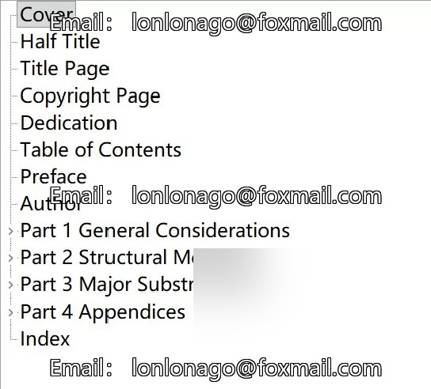
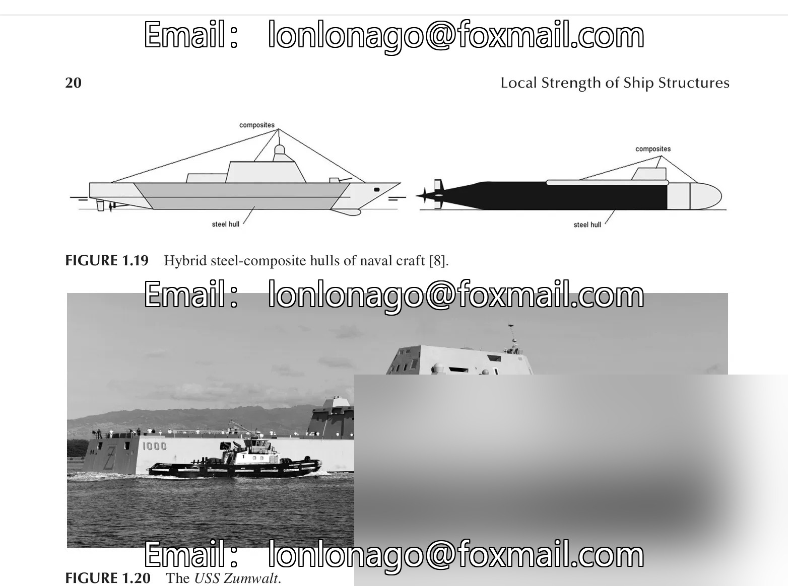

# "The Local Strength of Ship Structure"

## Body

"The Local Strength of Ship Structures" (780 pages). PDF version file

Part 1: General considerations - introducing basic theory, design principles, loads and specifications.

2. Part: Structural members - detailed analysis of strength and buckling issues of basic members such as hull beams, stiffeners, plates, and strengtheners.

Part Three: Main Lower Structural Parts - Deeper exploration of local strength in key areas such as the bottom of the ship, side, deck, bulkheads, and the bow and stern.

Part IV: Appendix - Providing necessary mathematical, mechanical tools and data support.

This is an important standard reference book or textbook for the field of shipbuilding and marine engineering, particularly for engineers, researchers, and students engaged in ship structure design, strength calculation, and safety assessment. It systematically explains how to analyze and ensure the safety and reliability of ship various local structures under complex loads.

This material covers "Local Strength of Ship Structures" including general considerations, structural component strength analysis, lower structure local strength, and appendices, along with CRC Press, Taylor & Francis Group, Piero Caridis copyright and page identifiers.

<!-- AI_ENRICHED -->

## Images

## Payment

Here is a pay link on Stripe ( https://buy.stripe.com/3cs8yP7sY87d0vu9AB ). Please contact me lonlonago@foxmail.com after funding $89, and I will send you a complete data files , thank you!

